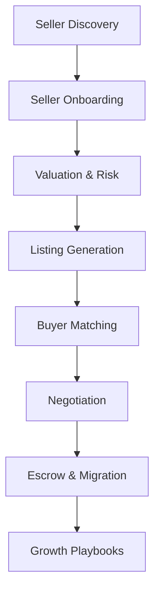
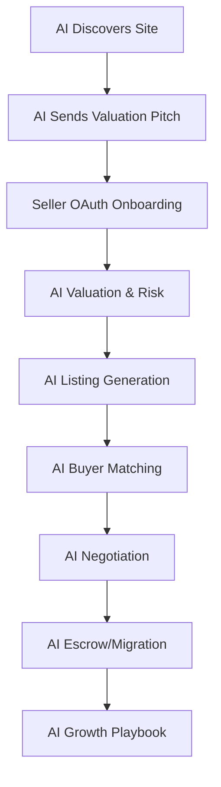

# AI-First Website Flipping Platform Architecture (95%+ Automation)

## Overview
This schematic describes the architecture for a fully AI-powered website flipping platform designed for 95%+ end-to-end automation. All major stages of the deal flow are primarily driven by AI/ML models, with manual intervention only for edge cases or legal/operational exceptions.

---

## 1. Data Flow & Process Map

---

## 2. Component-Level Automation

| Stage               | AI/ML Components                                      | Integration Points               |
|---------------------|-------------------------------------------------------|----------------------------------|
| Seller Discovery    | Web crawler, NLP pitch generator, LLM outreach agent  | Python (Scrapy), GPT-4           |
| Seller Onboarding   | Guided OAuth, auto business-type classification       | FastAPI, ML classifiers          |
| Valuation & Risk    | Ensemble ML models, LLM summarization, anomaly ML     | XGBoost, Prophet, GPT-4, spaCy   |
| Listing Generation  | LLM auto-draft, highlight extraction, red-flag NER    | GPT-4, spaCy, FastAPI            |
| Buyer Matching      | Semantic search, embeddings, preference learning      | SBERT, sklearn, FastAPI          |
| Negotiation         | LLM counteroffers, fairness band analysis             | GPT-4, decision trees            |
| Escrow & Migration  | Workflow engine, auto-step triggers, anomaly ML       | Airflow, Python, Escrow.com API  |
| Growth Playbooks    | LLM strategies, SEO/CRO API integration               | GPT-4, SEO APIs                  |

---

## 3. Automation Triggers & Feedback Loops
- Data is ingested via API/web scraping and passed through ML pipelines for classification, scoring, and summarization.
- **Automation triggers**: Upon seller onboarding, AI launches valuation, risk assessment, and auto-listing generation.
- **Feedback loops**: Buyer/seller actions, negotiation outcomes, migration issues are logged and used to retrain models (via scheduled batch jobs or real-time event streams).
- **Exception handling**: Edge-case manual review is triggered only when anomaly models flag legal, fraud, or technical uncertainties.

---

## 4. Tech Stack Summary (AI-First)
- **Frontend**: Next.js (React)
- **Backend**: FastAPI (Python)
- **Database**: PostgreSQL (+ Redis for caching)
- **ML Pipelines**: XGBoost, Prophet, SBERT, OpenAI/GPT-4 API
- **Integrations**: Stripe, PayPal, Escrow.com, Shopify, OAuth 2.0
- **Infra**: Docker, Kubernetes, AWS/GCP
- **Monitoring**: Sentry, Datadog

---

## 5. Example Process Automation Rates (Target: 95%+)
| Stage             | AI/ML Coverage | Manual | Key AI Actions |
|-------------------|---------------|--------|---------------|
| Seller Outreach   | 95%           | 5%     | AI finds, scores, contacts sellers |
| Onboarding        | 95%           | 5%     | OAuth, classification, anomaly detection |
| Valuation         | 98%           | 2%     | ML/LLM valuation, risk scoring |
| Listing           | 99%           | 1%     | LLM auto-draft, highlights |
| Matching          | 98%           | 2%     | Embeddings, semantic search |
| Negotiation       | 95%           | 5%     | Counteroffers, fairness bands |
| Escrow/Migration  | 95%           | 5%     | Workflow engine, migration automation |
| Growth Playbooks  | 95%           | 5%     | LLM strategies, APIs |

---

## 6. Diagram: Automated Seller Journey

---

## 7. Key Differentiators
- AI proactively creates deal flow (not just reactively listing sites).
- Semantic buyer matching with embeddings, not simple filters.
- Automated negotiation and post-acquisition growth support.
- Feedback-driven model retraining for continuous improvement.

---

## 8. Next Steps
- Implement individual AI modules for each stage.
- Define real-time feedback pipelines.
- Integrate anomaly detection for exception handling.
- Test automation coverage to hit 95% goal.
